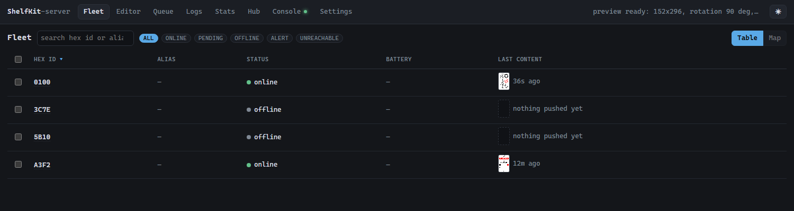
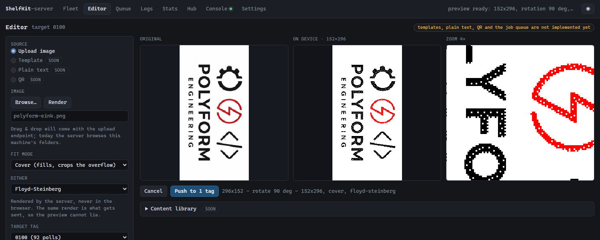
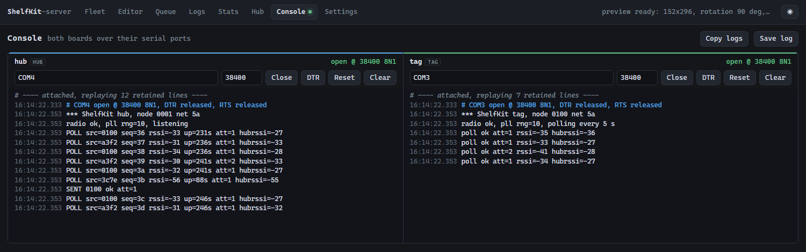
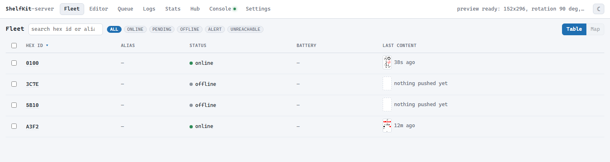

# ShelfKit

**An e-paper shelf-label system you can build, flash and drive yourself.** ShelfKit is a hub plus a
fleet of battery shelf tags: the tags poll a serial-attached hub over sub-GHz radio, the hub relays
content to them, and a local web app is where you watch the fleet and push what each tag should show.

It runs on real SES-imagotag / Vusion 2.6" labels (AX8052F143 + GDEW026Z39 black/white/red panel),
built from source with SDCC — no vendor cloud, no gateway subscription, nothing phoning home.



*Fleet — every tag that announced itself, its state, and the last frame pushed to it (thumbnails are
the real render, not a mockup).*



*Editor — pick an image, choose fit and dither, and see exactly what the glass will show, including a
4× zoom.*



*Console — every serial line from both boards, with the handshake lines and a reset button per pane.*

Every screen has a light and a dark palette: the button in the top bar switches between them and the
choice is remembered, or `?theme=light` / `?theme=dark` forces one for a link or a capture.



## How it works

```
 tag (battery)                                    hub (USB serial)              host
 ┌────────────────┐   POLL  ───────────────────►  ┌──────────────┐   hex lines  ┌──────────────┐
 │ AX8052F143     │   ◄─────── POLL_RSP (ACK)      │ AX8052F143   │  ◄────────── │ ShelfKit-    │
 │ + GDEW026Z39   │   ◄─────── DATA: CHUNKs ─────  │ + serial UART│  ──────────► │ Server       │
 └────────────────┘   ───────► ACK                 └──────────────┘   SENT …     └──────────────┘
```

- **Tags** wake once a minute, send a tiny `POLL`, and treat the hub's answer as the
  acknowledgement. The hub can then push an image to any tag that has just spoken; the tag streams the
  chunks straight into the panel controller (there is no RAM for a frame buffer) and refreshes.
- **The check-in adapts.** A tag stretches its own interval when the link is weak (up to 10 minutes),
  and collapses to hourly, then two-hourly, then daily when there is no hub at all, so a tag out of
  range cannot drain itself retrying. The hub can also ask it to wait longer. Between polls the radio,
  the MCU and the panel rail are all off - see [tag power](ShelfKit-Firmware/Vusion/README.md#adaptive-check-in).
- **The link** is reliable: sequence numbers, retries with jittered back-off, per-source duplicate
  filtering, and a 3-byte on-air address so several tags and networks can share the band. Details and
  the frame format are in [Documentation/wireless-link.md](Documentation/wireless-link.md).
- **The server** owns two serial ports (hub and, while developing, the tag itself), renders images for
  the panel, and serves the web UI. Everything is local: the page is plain HTML/JS on the standard
  library's HTTP server, so the only Python dependencies are `pyserial` and `pillow`.
- **Everything outbound is queued.** Nothing is fired at a tag when you click: a command waits for that
  tag's next poll, because a tag only listens for seconds after one. The Queue screen shows the queue,
  per command, with **Cancel all**.

## What works today

| Area | State |
|---|---|
| Firmware — hub | Polls answered, images relayed to tags, serial command channel, LED pulses, 868 MHz link |
| Firmware — tag | Polls with retry/back-off and an adaptive check-in, image reception straight to the panel, BWR refresh, identity in SPI flash, OTA receiver, deep-sleep radio + sleeping MCU between polls |
| E-paper driver | IL0373 init, 152×296 rotated portrait, black/white/red planes, BUSY-bounded waits |
| Build | SDCC 3.6.0 + the SDCC-MDF VS Code extension, three targets (tag, hub, bootloader) over one shared vendor tree |
| Server UI | Fleet (with per-tag and bulk **forget**, wireless **id assignment**, **firmware update**, **flash read-back** and **service labels**), Editor (with real previews), **Queue** (every command, its state, **Cancel all**), Logs, Stats, Hub, Console, Settings — light and dark |
| Image pipeline | Fit (cover/contain/stretch), threshold / Floyd-Steinberg / Bayer 4×4 dither, server-rendered previews, midtone warning |
| Image push | Reliable frame-by-frame transfer over the port the console already has open, with cancel and progress |
| **Storage** | Everything the server must remember across a restart, in one SQLite file: tag aliases/notes/positions, announcement counts and ages, the last frame per tag, the rendered bitmaps, the editor's image and options, the port each pane used, and the event history behind Logs |
| Service labels | The server draws a panel-sized label with the tag's wireless id, alias and a note, and pushes it over the air — the quickest way to match a tag in hand to a Fleet row |
| Tag power | The radio sits in the AX5043's own deep sleep (26 MHz crystal off), the MCU sleeps (`WTFLAG_CANSLEEPCONT`, both XRAM halves kept), the panel rail is off, and the wake-up timer runs from the 32 kHz crystal at 512 Hz. The listening window after a poll closes after 500 ms unless the hub said data is coming - estimated ~0.09 mA average, **~9 months on a CR2450**, still to be metered ([details](ShelfKit-Firmware/Vusion/README.md#power)) |
| OTA update | **Working on hardware.** The tag receives a new application into its SPI flash, verifies the CRC, does a real chip reset (`PCON.SWRESET`) and the bootloader programs it on that reset, with a blue/green/red LED pulse ([design](Documentation/ota-update.md)) |
| Tag identity | Random 16-bit node id on a brand new tag, stored in SPI flash; assignable over the air from the server's Fleet drawer (or `Tooling/set-id.py`); survives firmware updates ([design](Documentation/tag-identity.md)) |
| Tag health | Every poll carries the supply voltage; the Fleet shows volts and a CR2450 percentage, red below 2.5 V |
| Honest gaps | No templates or plain-text content, no stats history, no map view (hidden until a grid is configured), no auth, no partial refresh, and the three newest power modes still need metering |

Nothing above is a mockup: the screenshots are the running app, taken against simulated serial data
because a screenshot cannot include a physical tag.

## Repository layout

| Path | What it is |
|---|---|
| `ShelfKit-Firmware/` | One SDCC-MDF project per board: `Vusion/` (tag), `Vusion-Hub/` (hub), `Bootloader/` (serial bootloader), and room for the next tag type — see its [README](ShelfKit-Firmware/README.md) |
| `ShelfKit-Server/` | The host-side app: web UI, image pipeline, image push (see its [README](ShelfKit-Server/README.md)) |
| `ShelfKit-Firmware/Shared/` | Everything the firmwares use: Axsem SDK, prebuilt libraries, board definition, shared drivers. See [Shared/README.md](ShelfKit-Firmware/Shared/README.md) |
| `ShelfKit-Firmware/Tooling/` | Firmware-side host scripts: the flasher, the multi-target build script (`*-latest.hex`), the over-the-air sender, `set-id.py` and `flash-read.py` |
| `Documentation/` | Protocol notes, panel init research, pin map, datasheets, screenshots |

`Release/` (generated, git-ignored) holds the ready-to-flash HEX files.

The two firmware targets are separate SDCC-MDF projects on purpose — each has its own `src/main.c`
and can diverge — while the vendor SDK, board definition and shared drivers live once in `ShelfKit-Firmware/Shared/`.

## Getting started

### 1. Firmware

Requirements: [SDCC](https://sdcc.sourceforge.net/) (verified against 3.6.0) and VS Code with the
[SDCC-MDF extension](https://marketplace.visualstudio.com/items?itemName=dzantemir.sdcc-mdf).

**Open the target folder itself, not the repo root** — the extension activates on a
`sdcc-project.json` in the workspace folder, and the `../Shared/…` paths are resolved against it.

1. `File ▸ Open Folder…` → `ShelfKit-Firmware/Vusion-Hub` (or `ShelfKit-Firmware/Vusion`).
   Each target is its own SDCC-MDF project; the repo root is not one.
2. **Ctrl+Shift+B** — `firmware.ihx`, `.hex`, `.map` and `.mem` land in that target's `build/`.
3. Flash it: *SDCC: Flash* already runs
   [ShelfKit-Firmware/Tooling/axsem-flasher.py](ShelfKit-Firmware/Tooling/axsem-flasher.py), and the
   same script works from a shell. A tag that has no bootloader yet can be flashed with both at
   once — `build-all.py` writes `Release/vusion-full-*.hex` for exactly that.

To build **all** targets at once instead of one window per project (Vusion, Vusion-Hub and the
bootloader), with the HEX files collected and named for you:

```
python ShelfKit-Firmware/Tooling/build-all.py
```

It writes `Release/vusion-latest.hex`, `vusion-hub-latest.hex`, `bootloader-latest.hex` and the
combined `vusion-full-latest.hex` — `--version 1.2.0` names them `-1.2.0` instead, and the folder is
cleared of old HEX/MAP files on every run. See
[ShelfKit-Firmware/Tooling/README.md](ShelfKit-Firmware/Tooling/README.md).

Verified build: tag 34 KB, hub 27 KB, bootloader 9 KB of code; ~1 KB of the 8 KB XRAM; SDCC has no
spare internal RAM, so keep buffers in `__xdata`. The tag's OTA image window is 43 KB, of which the
application uses 34 KB.

### 2. Host app

```
pip install -r ShelfKit-Server/requirements.txt        # pyserial, pillow
python ShelfKit-Server/shelfkit-server.py hub=COM4 tag=COM3
```

It prints a URL and opens it. Ports named on the command line open at startup; anything else can be
opened from the **Console** tab. Then: **Console** to watch the boards, **Fleet** to see the tags that
announced themselves, **Editor** to pick an image, preview it and push it.

State lives in `ShelfKit-Server/data/shelfkit.db` — one SQLite file, created on first run. Restarting
brings back your image and its preview, the tags with their ages and aliases, the last frame pushed to
each one, and the event log. `--db PATH` keeps it elsewhere, `--no-store` forgets everything on exit,
and deleting the file resets it. See [ShelfKit-Server/README.md](ShelfKit-Server/README.md#state-on-disk).

### 3. Driving it from scripts or another service

The server is one HTTP API away from anything else (endpoints are documented at the top of
[ShelfKit-Server/shelfkit/webapp.py](ShelfKit-Server/shelfkit/webapp.py)):

```
GET  /api/state                       the whole world: panes, tags, editor, transfer
GET  /api/poll?c=hub=0:12,tag=0:3     new log lines per pane, plus the state
POST /api/preview                     render the picked image for the panel
POST /api/send    {"addr": 256}       push it to one tag
GET  /api/preview.png?t=…&kind=device the rendered frame as a PNG
```

For a shell, [ShelfKit-Server/shelfkit/hubhost.py](ShelfKit-Server/shelfkit/hubhost.py) does the same
without the page: `serve` watches announcements and pushes new images, `send` pushes one, `ping`
checks the hub.

## Making a release

`Release/` is git-ignored - it is build output - so a release is a git tag plus the four
HEX files as release assets:

```bash
# 1. name the artefacts after the version (this also clears the previous build)
python ShelfKit-Firmware/Tooling/build-all.py --version 1.0.0

# 2. tag the commit the build came from
git tag -a v1.0.0 -m "ShelfKit 1.0.0"
git push origin main --tags

# 3. attach the HEX files to a GitHub release for that tag:
#    https://github.com/BeatSkip/ShelfKit-skeleton/releases/new?tag=v1.0.0
```

Attach all four: `vusion-1.0.0.hex` (tag), `vusion-hub-1.0.0.hex` (hub),
`bootloader-1.0.0.hex` and `vusion-full-1.0.0.hex` (the tag bundle - the one to flash,
because the app-only hex bypasses the bootloader). The `.map` files next to them are
build output and do not belong in a release.

Building without `--version` produces `*-latest.hex` instead, which is what the build
script prints as the flash command; use it while iterating, and the versioned names when
you publish.

## Where this is going

ShelfKit is a **skeleton on purpose** — the point is to grow it. The direction:

### More kinds of tags

- **Panel abstraction.** Today the geometry, colour planes and init sequence for the GDEW026Z39 live in
  one driver. The next step is a panel table — size, colour set (mono / BWR / BWRY / 4-grey), init
  sequence, refresh times — so a new panel is a data file plus a driver, not a fork. Candidates:
  GDEW029Z10, GDEW042T2, the 2.9" and 4.2" waveshare families.
- **More board types.** The radio layer is already generic; other MCU tags (CC2510 imagotags, nRF52
  BLE labels) should be able to join the same fleet with a different transport and the same protocol.
- **Capability flags on the wire**, so the server learns per tag whether it has a battery gauge,
  partial refresh, a button, or a temperature sensor — instead of assuming the Vusion's feature set.
- **Partial refresh and rotation slots**, so a price can change without a 15-second full flash.

### A real API

- **Content history**: the store already keeps each tag's last frame and its bitmap across restarts,
  but only the last one, and nothing is deduplicated across tags.
- **A real job history**: the queue delivers and reports, but it is in memory — a restart forgets it,
  and there is no attempt count or retry history yet.
- **Live updates** over SSE/WebSocket instead of 200 ms polling, and an OpenAPI schema for the whole
  surface so other tools can generate clients.
- **Batch operations**: push to a selection, reflash a group, rotate content across slots.
- **Auth**: the spec's single shared password, and a deliberate decision about what is safe to expose
  beyond `127.0.0.1`.

### Integrations

- **Home Assistant**, first: MQTT discovery with one device per tag (state, RSSI, battery, last
  content as an image entity), plus a `shelfkit.push` service so an automation can put a price or a
  message on a specific shelf. The HTTP API above is already enough to prototype that.
- Generic **MQTT/HTTP webhooks** for everything else, a **Prometheus** endpoint for link quality, and a
  small CLI so a CI job or a cron can push content without the UI.
- Anything that can GET and POST JSON should be able to join the fleet — that is the design goal.

### Parametric templates

The biggest missing feature: content that is generated, not uploaded.

- **A tiny layout language** (or Jinja-ish templates) describing boxes, text, icons and QR codes on the
  152×296 canvas, using the fixed-width bitmap fonts the panel actually renders well.
- **Per-tag parameters**: `{{ price }}`, `{{ sku }}`, `{{ shelf }}` — values provided by the tag's
  record, by an MQTT topic, or by Home Assistant.
- **Deterministic rendering**, so the same parameters and template produce the same bitmap and the same
  SHA-256. That makes "has this tag changed?" a hash comparison rather than a full transfer.
- **Preview in the editor** using the same pipeline that renders for the panel — which is already the
  case for uploaded images, so templates slot into an existing guarantee rather than a new one.

Non-goals, so the scope stays sane: no React SPA, no drag-and-drop layer editor, no multi-user
accounts, no per-tag latency graphs, no mobile app (the web UI is responsive, that is all).

## Documentation

| Document | Contents |
|---|---|
| [Documentation/wireless-link.md](Documentation/wireless-link.md) | The radio protocol, frame format, retries, hub command channel, image transfer |
| [Documentation/ota-update.md](Documentation/ota-update.md) | How an over-the-air update is stored, verified and applied, and the LED indications |
| [Documentation/tag-identity.md](Documentation/tag-identity.md) | The identity record, the flash sector map, the switched flash rail |
| [Documentation/ax8052-errata.md](Documentation/ax8052-errata.md) | Which AX8052 silicon erratas this firmware works around, and how |
| [Documentation/GDEW026Z39-init-reference.md](Documentation/GDEW026Z39-init-reference.md) | Where every panel init byte came from |
| [Documentation/signal-list.md](Documentation/signal-list.md) | Pin map of the Vusion board |
| [ShelfKit-Server/README.md](ShelfKit-Server/README.md) | The web app: screens, image pipeline, HTTP API |
| [ShelfKit-Firmware/Tooling/README.md](ShelfKit-Firmware/Tooling/README.md) | Flashing, flash dumps, log monitoring, protocol tests |
| [ShelfKit-Server/docs/web-interface-implementation.md](ShelfKit-Server/docs/web-interface-implementation.md) | The interface spec the UI follows |

## Notes

- **License:** the code in each `src/` has no license declared yet. The Axsem SDK under
  `ShelfKit-Firmware/Shared/sdk/` and `ShelfKit-Firmware/Shared/lib/` keeps its original terms —
  compiler headers are GPL with a linking exception, the rest is vendor-licensed.
- `ShelfKit-Firmware/Shared/lib/*.lib` are SDCC archives built from
  `ShelfKit-Firmware/Shared/sdk/` with the vendor's `buildsdcc`
  makefiles; `libmf.lib` is committed in patched form (see [ShelfKit-Firmware/Tooling/README.md](ShelfKit-Firmware/Tooling/README.md)).
- The screenshots in this README are the real UI (`?theme=dark` forces the palette for a capture)
  driven by simulated serial data, since no photograph can include a physical tag.
