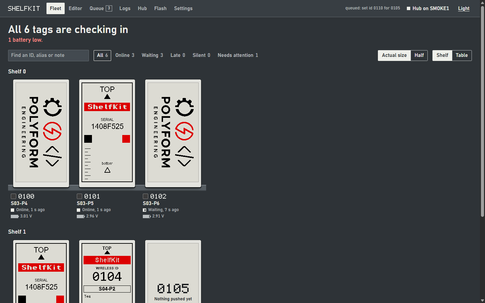
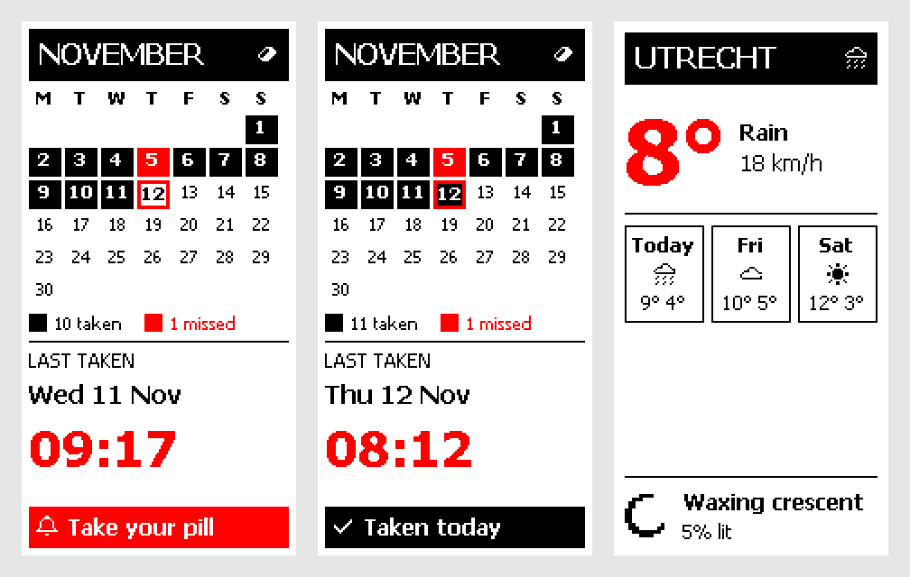
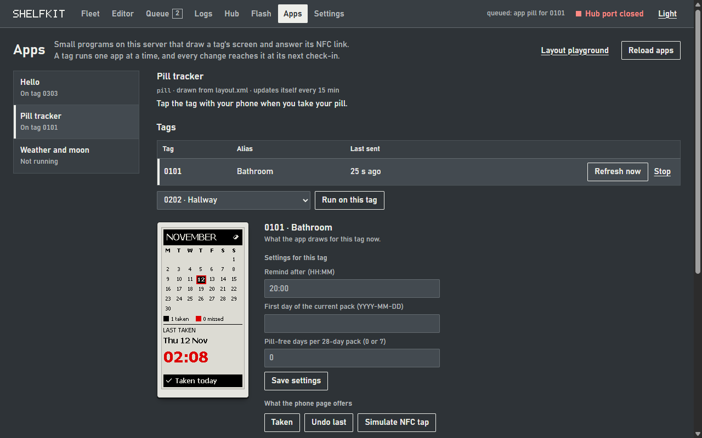
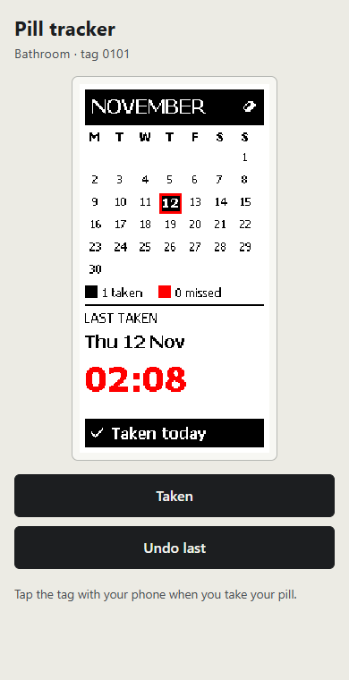
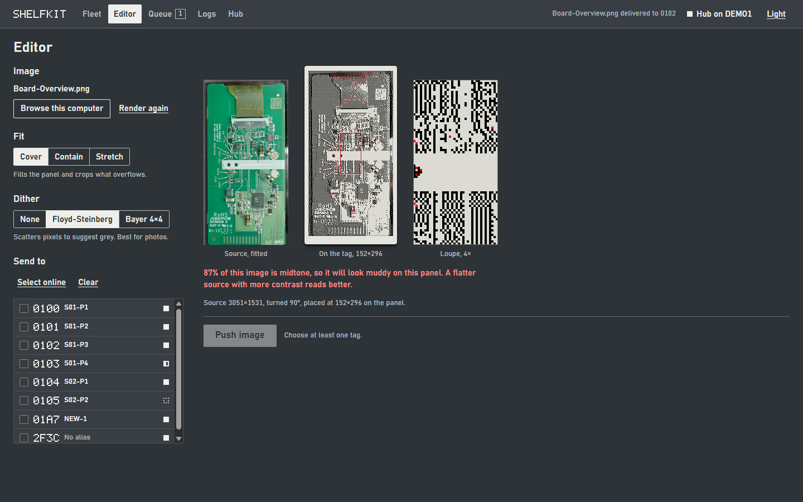
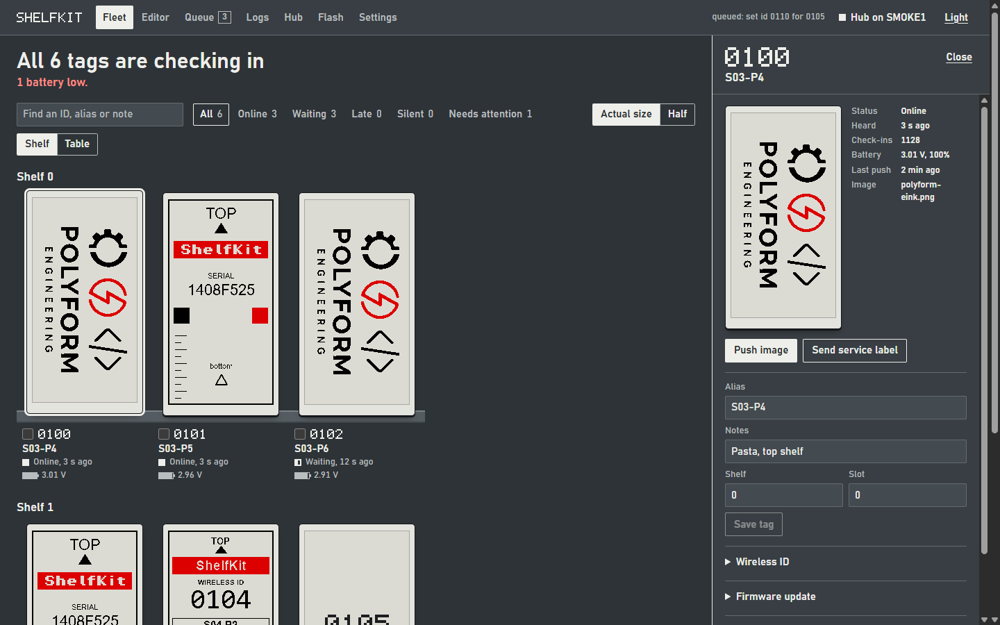
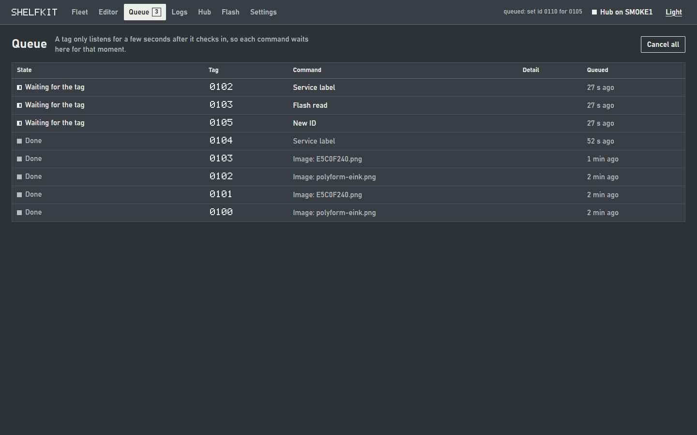
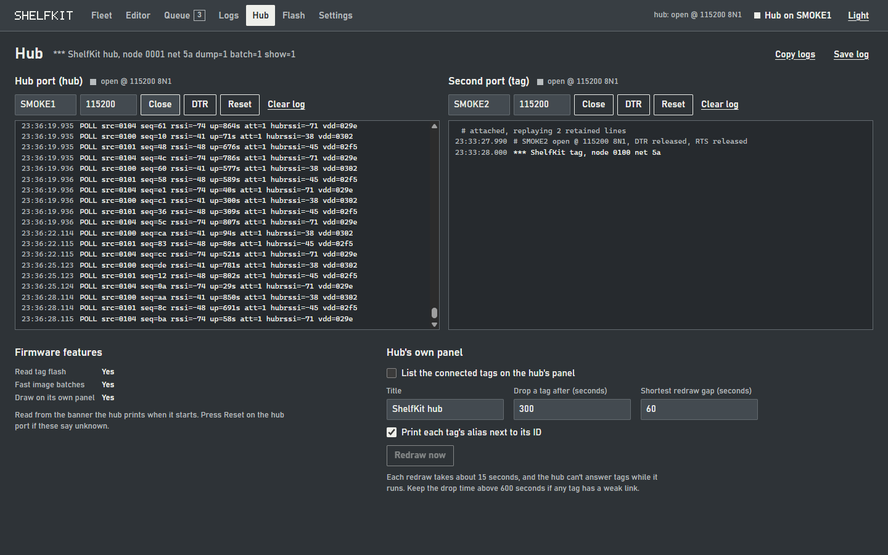
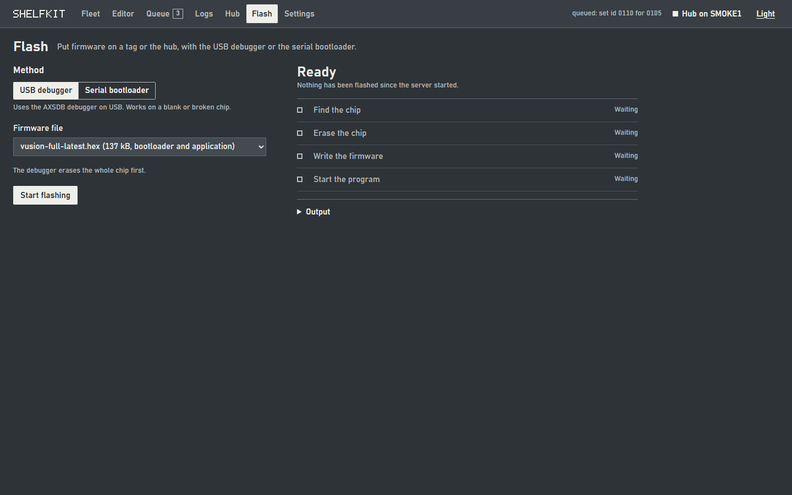
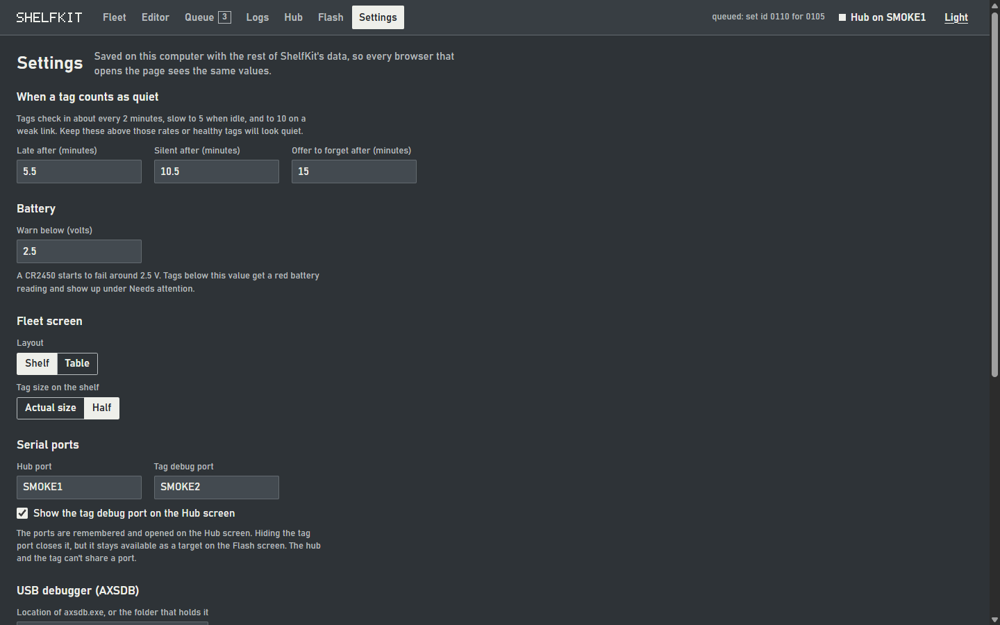

# ShelfKit

**Supermarket shelf labels, repurposed into little e-paper screens you own.** ShelfKit turns
SES-imagotag / Vusion 2.6" price tags (AX8052F143 radio MCU, 152×296 black/white/red panel, one
CR2450 coin cell) into a fleet you drive from your own computer: custom firmware for the tags and a
USB hub, and a local web app that pushes images and runs small apps on them.

No vendor cloud, no gateway subscription, nothing phoning home. Everything is built from source with
SDCC and Python's standard library.



*The Fleet screen: every tag that checked in, at true panel size on its shelf, with its state,
battery and the exact frame it is showing.*

## What it can do

- **Push any image to any tag.** Pick a picture, choose fit and dither, see exactly what the glass
  will show, and send it. The image goes out at the tag's next check-in, chain-code compressed when
  that helps, so a typical label takes about 30 radio frames instead of 404.
- **Run apps on tags.** Small Python apps (*InkServices*) own a tag's screen: they draw it, update it
  on a timer and react when someone taps the tag with a phone. A pill tracker, weather with the moon
  phase, and a hello-world counter come with it.
- **Tap a tag, get its page.** Each tag's NFC chip holds a link to `/tag/<ID>` on your server. A
  phone tap opens that tag's app page with its buttons, and the tag shows the result.
- **Design screens as text.** *InkLayout* is a small XML layout language made for this panel:
  rows, grids, text that fits, icons, the three colours, and a renderer that tells you what
  overflowed. It is simple enough that a cheap AI model can write layouts from a skill file.
- **Look after the fleet.** Over-the-air firmware updates, wireless ID assignment, flash read-back,
  factory reset, service labels for finding a tag in hand, and per-tag battery history with a drain
  estimate.
- **Sip power.** Between polls the radio, the MCU and the panel rail are all asleep. The check-in
  interval adapts (30 s while busy, 5 min idle, up to a day with no hub in range), so a lost tag can't
  drain itself.

## Apps on your tags



*Real renders at 2×, exactly the pixels the tags get: the pill tracker after the reminder time and
after a tap, and the weather app.*

An app is a folder in `ShelfKit-Server/inkapps/` with an `app.py` and, usually, a `layout.xml`. This
is the whole hello app:

```python
from shelfkit.inkservices import InkApp

app = InkApp("hello", title="Hello", description="A counter and a message, set from your phone",
             layout="layout.xml")
app.config_field("greeting", label="Greeting", default="Hello!")

@app.data
def data(tag):
    return {"greeting": tag.config.get("greeting", ""), "n": tag.data.get("n", 0)}

@app.button("Press me")
def press(tag):
    tag.data["n"] = tag.data.get("n", 0) + 1
```

```xml
<screen padding="6" gap="6">
  <row bg="black" padding="4 6"><text color="white" bold="true" size="16">{{ tag.alias }}</text></row>
  <text size="14" bold="true" fit="shrink">{{ data.greeting }}</text>
  <text size="64" bold="true" color="red" fit="shrink">{{ data.n }}</text>
</screen>
```

The host takes care of the rest:
- Each app gets its own SQLite file with per-tag settings and data.
- `@app.every(minutes=30)` runs on a scheduler.
- `@app.on_open` fires on an NFC tap.
- A screen identical to the last one is never sent, which saves the battery.
- An app that crashes logs its error and leaves every other tag alone.

<table><tr>
<td width="68%"></td>
<td width="32%"></td>
</tr><tr>
<td><em>The Apps screen: which tags run each app, a live preview, per-tag settings, the phone
buttons to try, stored data and the app's log.</em></td>
<td><em>What a phone sees after tapping the tag. Plain HTML, no script, so it works in any browser.</em></td>
</tr></table>

The **layout playground** (`/inkapps.html`) renders InkLayout as you type, and
`GET /api/layout/skill` hands a model everything it needs to write layouts. See
[Documentation/InkServices.md](Documentation/InkServices.md) for the vision and
[Documentation/InkLayout.md](Documentation/InkLayout.md) for the language.

## The rest of the web app

| | |
|---|---|
|  |  |
| **Editor**: pick an image, choose fit and dither, preview the real render with a 4× zoom, and push it to one or many tags. | **Inspector**: a tag's frame, alias, notes, shelf slot, battery history, and (folded away) ID, firmware update, flash read-back and reset. |
|  |  |
| **Queue**: every command waits for its tag's next check-in, with live progress and **Cancel all**. | **Hub**: both serial ports live, handshake lines, a reset button, and the hub's own e-paper panel. |
|  |  |
| **Flash**: program a chip from the page, via the AXSDB debugger or the serial bootloader. | **Settings**: thresholds, fleet layout, the address phones use for tag pages, and CSV import/export. |

Every screen comes in light and dark. `?theme=light` or `?theme=dark` forces one.

## How it works

```
 tag (battery)                                    hub (USB serial)              host
 ┌────────────────┐   POLL  ───────────────────►  ┌──────────────┐   hex lines  ┌──────────────┐
 │ AX8052F143     │   ◄─────── POLL_RSP (ACK)      │ AX8052F143   │  ◄────────── │ ShelfKit-    │
 │ + GDEW026Z39   │   ◄─────── DATA: CHUNKs ─────  │ + serial UART│  ──────────► │ Server       │
 └────────────────┘   ───────► ACK                 └──────────────┘   SENT …     └──────────────┘
```

- **Tags poll; the hub answers.** A tag wakes, sends a tiny `POLL`, and listens for a moment. If
  something is queued for it, the hub streams the image, and the tag writes the chunks straight into
  the panel controller, since there is no RAM for a frame buffer.
- **So everything is queued.** Nothing is fired at a tag when you click. Commands wait for that tag's
  next poll, and the server *pre-arms* the hub so the poll reply says "stay awake, data follows".
- **The link is reliable**: sequence numbers, jittered retries, duplicate filtering and a 3-byte
  on-air address. See [Documentation/wireless-link.md](Documentation/wireless-link.md).
- **NFC wakes a tag.** Hold a phone to it and the tag checks in within a second, then again shortly
  after, so whatever the tap did shows up quickly.
- **The server** is plain Python (`pyserial` and `pillow` are the only dependencies): web UI, image
  pipeline, app host and SQLite state, on one port.

## What works today

| Area | State |
|---|---|
| Tag firmware | Adaptive polling with back-off, images (raw or ECO-compressed) straight to the panel, identity in SPI flash, OTA updates, NFC field wake, deep sleep between polls |
| Hub firmware | Relays polls, images and batches, serial command channel at 115200, flash read-back relay, draws on its own panel |
| OTA updates | **Working on hardware.** CRC-checked image in SPI flash, real chip reset, programmed by the bootloader ([design](Documentation/ota-update.md)) |
| Server | Fleet, Editor, Queue, Logs, Hub, Flash, Apps and Settings screens; a tag inspector reachable from anywhere |
| InkServices | App SDK, per-app SQLite stores, timers, NFC-tap hooks, phone pages at `/tag/<ID>`, duplicate-push suppression; pill, weather and hello apps |
| InkLayout | Layout language, renderer with overflow warnings, playground, model skill file, CLI (`python -m shelfkit.inklayout render`) |
| Storage | One SQLite file: tags, aliases, shelf positions, last frames, battery history, power measurements, settings and the event log |
| Tag power | Radio in deep sleep, MCU sleeping, panel rail off between polls. **The figures are datasheet models, not measurements.** See [power](ShelfKit-Firmware/Vusion/README.md#power) and [the deep dive](Documentation/power-deepdive.md) |
| Honest gaps | The command queue is in memory, so a restart forgets pending pushes. There is no auth, so keep the admin page on localhost. Tag firmware doesn't yet put its own ID into the NFC link (below). Apps run in the server process. No partial refresh yet. Power still needs metering on a real tag |

## Getting started

### 1. Firmware

You need [SDCC](https://sdcc.sourceforge.net/) (verified with 3.6.0). VS Code with the
[SDCC-MDF extension](https://marketplace.visualstudio.com/items?itemName=dzantemir.sdcc-mdf) is
optional and handy for single-target builds; open `ShelfKit-Firmware/Vusion` or `Vusion-Hub` itself,
not the repo root. To build everything at once:

```
python ShelfKit-Firmware/Tooling/build-all.py
```

This writes `Release/vusion-latest.hex` (tag), `vusion-hub-latest.hex`, `bootloader-latest.hex` and
`vusion-full-latest.hex`. The last one is tag plus bootloader, for a tag's first flash. Flash with
[axsem-flasher.py](ShelfKit-Firmware/Tooling/axsem-flasher.py) or from the server's Flash screen.
The tag application nearly fills its 43,006 B OTA window, so new firmware features have to earn
their bytes. Details are in [Tooling/README.md](ShelfKit-Firmware/Tooling/README.md).

### 2. The server

```
pip install -r ShelfKit-Server/requirements.txt        # pyserial, pillow
python ShelfKit-Server/shelfkit-server.py hub=COM4
```

It opens the page in your browser. **Fleet** shows tags as they check in, **Editor** pushes an image,
and **Apps** puts an app on a tag. State lives in `ShelfKit-Server/data/shelfkit.db`; `--db PATH`
puts it elsewhere.

### 3. Phones and NFC

Tag pages are served on the same port as everything else, at `/tag/<ID>`. To reach them from a
phone:

1. Put a reverse proxy in front and **forward only `/tag/`** (and the legacy `/t/`). The rest of
   the port is the admin page, which can flash chips and drive serial ports.
2. Enter the proxy's address under **Settings › Address phones use**. The Apps screen then shows
   each tag's exact link.
3. Write `https://<your-proxy>/tag/<ID>` to the tag with any NFC writer app.

> Today's tag firmware rewrites the NFC chip at boot. Build with `SHELF_NFC_NDEF_SYNC 0` until
> it learns to keep your link and fill in its own ID. That is the next firmware step, and it keeps
> one shared binary for every tag.

### 4. Scripting

Everything the page does is a JSON API on the same port. The endpoints are listed at the top of
[webapp.py](ShelfKit-Server/shelfkit/webapp.py) and
[inkservices/web.py](ShelfKit-Server/shelfkit/inkservices/web.py). Requests from a foreign `Origin`
are refused. For the shell, [hubhost.py](ShelfKit-Server/shelfkit/hubhost.py) can push an image
without the page.

### 5. Making a release

`Release/` is git-ignored build output, so a release is a git tag plus four HEX files:

```bash
python ShelfKit-Firmware/Tooling/build-all.py --version 1.0.0   # names the files -1.0.0
git tag -a v1.0.0 -m "ShelfKit 1.0.0" && git push origin main --tags
```

Attach `vusion-1.0.0.hex`, `vusion-hub-1.0.0.hex`, `bootloader-1.0.0.hex` and
`vusion-full-1.0.0.hex` to a GitHub release for that tag. The full bundle is the one to flash on a
tag, because the app-only hex skips the bootloader. The `.map` files stay out.

## Repository layout

| Path | What it is |
|---|---|
| `ShelfKit-Firmware/` | SDCC projects: `Vusion/` (tag), `Vusion-Hub/` (hub), `Bootloader/`, `Shared/` (SDK, drivers), `Tooling/` (build, flash, OTA, ID scripts) |
| `ShelfKit-Server/` | The web app, image pipeline, `shelfkit/inkservices/` (app host), `shelfkit/inklayout/` (layout language) and `inkapps/` (the apps). See its [README](ShelfKit-Server/README.md) |
| `Documentation/` | Protocol, power, NFC, OTA and panel notes, datasheets, plans, screenshots |
| `Resources/`, `Data/` | Sample images; captured flash dumps |

## Where this is going

- **More apps from the [InkServices idea list](Documentation/InkServices.md)**: waste collection,
  commute, calendar, chores, a message board.
- **A dev mode** with an in-browser editor and a virtual tag, then an **AI layout chat**: describe a
  screen and watch the virtual tag update.
- **Install apps from git**, each in its own process, with an advisory AI review before an app is
  enabled.
- **Firmware**: keep the NFC link and fill in the tag's ID, poll faster for a minute after a tap,
  partial refresh, and more panel sizes than 152×296.
- **Integrations**: Home Assistant over MQTT, webhooks, and a persistent job queue.

Deliberately out of scope: multi-user accounts, a drag-and-drop editor and a native mobile app. The
web pages are the app.

## Documentation

| Document | Contents |
|---|---|
| [InkServices.md](Documentation/InkServices.md) | The apps vision: what InkServices are for, the app ideas |
| [InkLayout.md](Documentation/InkLayout.md) | The layout language, renderer, skill file and status |
| [plans/2026-11-11-inkservices.md](Documentation/plans/2026-11-11-inkservices.md) | The implementation plan, progress and roadmap |
| [wireless-link.md](Documentation/wireless-link.md) | Radio protocol, frame format, retries, image transfer |
| [ota-update.md](Documentation/ota-update.md) | How an over-the-air update is stored, verified and applied |
| [tag-identity.md](Documentation/tag-identity.md) | The identity record and flash sector map |
| [power-deepdive.md](Documentation/power-deepdive.md) | The CR2450 budget and power options |
| [nfc-field-detect.md](Documentation/nfc-field-detect.md) | NFC wake-on-field: pin, EEPROM config, findings |
| [ses-imagotag-vusion.md](Documentation/ses-imagotag-vusion.md) | One-page context sheet for the tag |
| [signal-list.md](Documentation/signal-list.md) | Pin map of the Vusion board |
| [ShelfKit-Server/README.md](ShelfKit-Server/README.md) | The web app in depth: screens, pipeline, API, compression |
| [Tooling/README.md](ShelfKit-Firmware/Tooling/README.md) | Building, flashing, OTA sending, ID assignment, flash read-back |

## Notes

- **License:** the code in each `src/` has no license declared yet. The Axsem SDK under
  `ShelfKit-Firmware/Shared/` keeps its original terms: compiler headers are GPL with a linking
  exception, and the rest is vendor-licensed.
- The screenshots are the running app with simulated serial data, since a screenshot can't include
  a physical tag. The tag renders are the real output of the apps.
