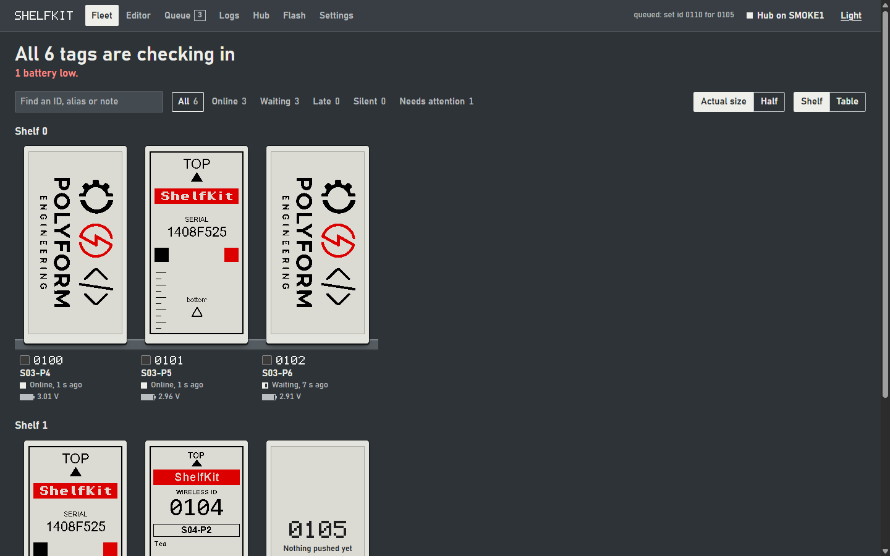

# ShelfKit-Server — browser UI and image push for the ShelfKit hub and tags

A local web app over the hub's serial port, with eight screens: **Fleet** (home), **Editor**, **Queue**,
**Logs**, **Hub**, **Flash**, **Apps** and **Settings**. Clicking a tag anywhere opens its inspector. Every control on the page does
something real; screens that were only placeholders are gone.



More captures (Editor, Queue, Hub, Flash, Apps, Settings, the inspector, a tag's phone page) are in the
[top-level README](../README.md); all of them are the running app against simulated serial data.

```
ShelfKit-Server/
  shelfkit-server.py     the app - the only thing you run
  shelfkit/              supporting modules, imported by it
    app.py                 panes, logs, tags, the command queue, the image push (no UI)
    serial_link.py         ports, handshake lines, the reader thread
    store.py               the SQLite state file: settings, tags, bitmaps, events
    prefs.py               the Settings values and their validation
    webapp.py              the HTTP/JSON layer over app.py
    static/                the page itself: index.html, app.js, style.css
    hubhost.py             hub command channel, image framing, and its own CLI
    eco.py                 ECO chain-coding compression of the two planes
    preview.py             fit / dither / quantise, shared by preview and push
    png2epd.py             PNG -> the two 1-bit planes the panel streams
    firmware.py            HEX -> OTA image, opcodes and CRC (shared with ota-send.py)
    flashdump.py           tag flash read-back framing (shared with flash-read.py)
    flasher.py             the Flash screen: AXSDB and serial-bootloader programming
    service_image.py       the service label a tag can be told to show
    hub_display.py         the connected-tags list on the hub's own panel
    stats_image.py         the host-stats picture (hubhost.py show / stats)
  tests/smoke.py         end-to-end check against fake serial ports
  docs/                  the interface spec this layout follows
  requirements.txt       pyserial, pillow
```

Only `pyserial` and `pillow` are needed: the server is the standard library's `http.server` and the
page is plain HTML/JS, with no framework and no build step.

## The two line rates

The **applications** run their UART at 115200 (that is what the server opens, and what
`DEFAULT_BAUD` sets). The **bootloader** on the same wire still runs at 38400, because it
is not reflashable on a flashed board. Both are correct and they do not have to match:

- `axsem-flasher.py` defaults to **38400**, because it talks to the bootloader.
- The server opens at **115200**, because it talks to the application.
- The bootloader's few boot lines (`OTA jedec`, `OTA image`, `boot mode ...`) arrive at
  38400 and show up in the console as noise. They are readable with a 38400 terminal,
  or by reopening that pane at 38400 from the console.
- One consequence: the server's "did the board come up in its bootloader?" learning,
  which watches those lines, cannot see them at 115200. Set a pane to 38400 before
  relying on it.

## Install and run

```
pip install -r ShelfKit-Server/requirements.txt

python ShelfKit-Server/shelfkit-server.py hub=COM4 tag=COM3
python ShelfKit-Server/shelfkit-server.py hub=COM4                 # second pane stays free
python ShelfKit-Server/shelfkit-server.py --baud 115200 hub=COM4 tag=COM3
python ShelfKit-Server/shelfkit-server.py --port 9000 --no-browser
python ShelfKit-Server/shelfkit-server.py --db ../lab-state.db     # keep state elsewhere
python ShelfKit-Server/shelfkit-server.py --no-store               # forget everything on exit
python ShelfKit-Server/shelfkit-server.py --list
```

It prints the URL and opens a browser window on it:

```
ShelfKit server on http://127.0.0.1:8765/
  hub    COM4         open @ 115200 8N1
  tag    COM3         open @ 115200 8N1
Ctrl+C to stop
```

Ports named on the command line are opened at startup; ports that only come from the auto-detected
list are pre-filled but left closed. `--baud` sets the initial rate for both panes (default 115200,
the firmware's UART0 rate). The page listens on **127.0.0.1** by default — it can drive a serial port
and read image files on this machine, so it is not meant to be reachable from elsewhere;
`--host 0.0.0.0` is there deliberately if you want it on your LAN.

### Opening the ports

Two ways:

- **On the command line** — `hub=COM4 tag=COM3` opens those two at startup, which is the usual way.
- **In the page** — the **Hub** screen holds the two panes: type or pick the port, set the baud,
  press **Open** on each. **DTR**, **Reset** and **Clear log** sit on the same row.

The top bar always shows the hub port's state. When the port is closed, Fleet says so in its headline
and offers a button that opens it, so an empty shelf never looks like a broken page.

### Light and dark theme

The button at the right of the top bar switches between them; it shows the theme you would switch
*to*. The choice is remembered in `localStorage` under `shelfkit-theme` and applied by a small
inline script in `<head>`, so a reload comes up in the right palette without a flash of the other
one. On a first visit (nothing stored yet) the page follows the OS (`prefers-color-scheme`); after
that your explicit choice wins. `?theme=light` or `?theme=dark` in the URL forces one for a link or a
screenshot without touching what is saved.

Both palettes are the same layout with a different token set — `:root` holds the dark defaults and
`[data-theme="light"]` overrides the colours, so no rule hard-codes a colour outside those two
blocks. `color-scheme` is set per theme too, which keeps scrollbars and native controls in step.

## The screens

The page uses the panel's own inks: black, white and red on shelf-steel grey. Red only ever means
"this needs you". State is also carried by shape, so it reads without colour. Tag IDs are drawn in a
small bitmap font, and tags stay paper-coloured in both themes because they are physical objects.

| Screen | What it does |
|---|---|
| **Fleet** | A headline saying how many tags are checking in and what needs you. **Shelf** view: each tag at true panel size (or half) with the frame last pushed to it, on rails grouped by the shelf and slot you set in the inspector. A tag's panel plays a refresh when a new frame lands. **Table** view: sortable, for larger fleets. Search covers IDs, aliases and notes. Filter by status, select tags, then push an image, send service labels or forget them |
| **Inspector** | Opens from any tag, on any screen. The tag's frame and facts; alias, notes, shelf and slot; push and service label; then wireless ID, firmware update, flash read-back, forget and factory reset, folded away until wanted |
| **Editor** | Browse this machine's folders, then choose **fit** and **dither**. Three previews from the server's render: source, the frame as the tag shows it, and a 4× loupe that follows the pointer or arrow keys. A midtone warning. Push to **one tag or several**; Push stays disabled until a preview is rendered |
| **Queue** | Every outbound command (image, firmware, ID, factory reset, service label, flash read) waits here until its tag checks in. Live state and frame progress per command, and **Cancel all** |
| **Logs** | Events recorded by the server (`push`, `ok`, `fail`, `error`, `boot`, `bootloader`, `open`, ...), identical neighbours collapsed into `×N`, filtered by tag or event, **kept across restarts**. Check-ins (`sync`) are hidden unless you ask for them, because every poll makes one |
| **Hub** | Both serial panes (port, baud, Open/Close, DTR, Reset, Clear log, live log, and a **send box** to write text or hex bytes to the port with a chosen line ending), Copy logs and Save log, the features the hub's firmware reports, and the settings for the hub's own panel. The port and baud you used come back next run. `#console` links land here |
| **Flash** | Put firmware on a chip from the page, with the **USB debugger** (AXSDB) or the **serial bootloader**. Pick the file from `Release/`, press Start, press again to confirm. Four steps (find the chip, erase, write, start) show as they happen, with the tool's own output underneath. See [Flashing](#flashing-from-the-page) |
| **Apps** | The InkServices apps in `inkapps/`: which tags run each one, a live preview, per-tag settings, the phone-page buttons to try (and Simulate NFC tap), stored data and the app's log. **Run on this tag** gives an app a tag's screen. Links to the layout playground. See [Documentation/InkServices.md](../Documentation/InkServices.md) and the [plan](../Documentation/plans/2026-11-11-inkservices.md) |
| **Tag pages** | `/tag/<ID>` on the same port: what a phone opens from the tag's NFC link. Plain HTML forms with the app's buttons and the tag's current screen. Forward only `/tag/` (and `/t/`) through a reverse proxy, and set its address under Settings. Code and routes: `shelfkit/inkservices/phone.py` |
| **Settings** | When a tag counts as late or silent, when to offer to forget it, the low-battery voltage, the Fleet layout and tag size, and the address phones use for tag pages. A CSV of aliases, notes, shelf and slot can be exported and imported. Saved by the server (the `prefs` setting in the state database), so every browser and every restart sees the same values; an impossible combination is refused with a message and nothing is stored |

### Tag status

Tags check in every 2 minutes, back off to 5 when idle and to 10 on a weak link, so "online" is
judged against those rates. The times below are the defaults; change them in **Settings**.

| Status | Meaning |
|---|---|
| **Online** | heard in the last 5½ minutes |
| **Late** | heard in the last 10½ minutes: slower than the idle rate, within the weak-link rate |
| **Silent** | not heard for longer than that |
| **Waiting** | a command is queued for its next check-in |
| **Sending** | a command is running now |

**Needs attention** is separate: a battery below the Settings voltage (2.5 V by default), or a last
command that failed.

### Flashing from the page

**Flash** → pick a method and a file → **Start flashing**, then press again to confirm (it erases).

| | USB debugger | Serial bootloader |
|---|---|---|
| Needs | the AXSDB debugger on USB; set where `axsdb.exe` is in **Settings** (found by itself in the default install) | a serial adapter with DTR on the chip's BOOT pin and RTS on its reset, on one of the two panes |
| Runs | `axsdb.exe --eraseall --flashprog <file>`, from AXSDB's own `bin` folder | the protocol of `ShelfKit-Firmware/Tooling/axsem-flasher.py`, in the server: banner, erase, HEX lines, run |
| Steps | `Programming Serial …` → find the chip, `Bulk erase...` → erase, `Flash program...` → write, `Run program...` → start; the exit code decides success | the same four steps, with a line count while writing |
| Pane | untouched | closed for the transfer at 38400, reopened afterwards |

**`--eraseall` wipes the whole chip, bootloader included.** The debugger path therefore only accepts a
`*-full-*.hex` (bootloader and application) unless you tick *Erase the bootloader as well*; the server
enforces that, not just the page. The serial path erases only the application.

Only one flash runs at a time. The **debugger** never touches the hub, so it runs beside whatever the hub
is doing. A **serial** flash through the *other* port does too; only a serial flash through the hub's own
port waits for the hub to be idle (and holds the queue until it is over). **Stop** ends it early, but the chip may be left
half-programmed; flash again to recover. The page remembers nothing between flashes except the log of
the last one (kept in memory until the server restarts); each flash also leaves a `flash` row in **Logs**.

### Settings API

```
POST /api/prefs      {"late_after_s": 330, "silent_after_s": 630, "forget_after_s": 900,
                      "low_battery_v": 2.5, "fleet_view": "wall", "wall_size": "full",
                      "axsdb_path": "C:\\Program Files (x86)\\ON Semiconductor\\AXSDB\\bin",
                      "hub_port": "COM4", "tag_port": "COM5", "show_tag_port": true}
GET  /api/aliases.csv      hex_id,alias,notes,shelf,slot for every tag
POST /api/aliases          {"csv": "..."}  apply a CSV; bad rows are reported, good rows applied
```

`axsdb_path` may be the program or its folder, is checked when saved (it must be an `axsdb.exe`), and is
stored as the program's path. Empty means "look in the default install". `hub_port` and `tag_port` are the two serial panes' ports (remembered, and reopened if the pane was open);
they can't be equal, and the hub's can't change mid-transfer. `show_tag_port: false` hides the tag debug
pane and closes it. Any subset of the keys can be sent. The current values are in `GET /api/state` under `prefs`. A
value outside its range, or times that are not in order (late < silent < forget), returns 400 with
the reason and changes nothing. The code is in `shelfkit/prefs.py`.

```
GET  /api/flash          the flash state and its output, plus the .hex files in Release/
POST /api/flash          {"method": "debugger"|"serial", "path": "...hex", "pane": "tag", "allow_partial": false}
POST /api/flash/cancel   stop it
```

`POST /api/flash` answers 409 with the reason when it can't start (`needs_confirm: true` for a
debugger flash of an image without the bootloader). The code is in `shelfkit/flasher.py`.

Every POST is refused with 403 when its `Origin` is another site: a page you happen to have open can
send a form to `127.0.0.1`, and this server drives serial ports and runs the flasher.

## The working parts, in detail

### The serial panes (Hub screen)

One pane per port, each with its own port field (type it, or pick a detected port from the list), baud
rate, **Open/Close**, **DTR**, **Reset**, **Clear**, and its log below.

Under the log is a **send box** for debugging: type text (or tick **Hex** and type bytes such as `50 0A`),
pick the line ending (LF, CR+LF, CR, none) and press Send. The bytes go straight to the port, around the
command queue, and are echoed in the log as `# > ...`; Up/Down recall earlier lines. It is refused while a
flash owns the port, and it is only enabled while the port is open. On the hub port `P` answers `PONG`.

Both handshake lines start **released** (DTR low, RTS low). On this board DTR is the BOOT pin and RTS
the RESET line. **DTR** is a level toggle — it holds the boot pin where you put it — while **Reset** is
a push button: the server asserts RTS and releases it 100 ms later on a timer, because a reset line
left asserted would hold the board in reset. Each press is logged in that pane.

**Reset first puts the BOOT pin where the firmware runs**, because a BOOT pin held in bootloader mode
is the one way a reset comes up in the *serial bootloader* — the board then prints
`AX8052 Bootloader V1.1` instead of its firmware banner, stops polling, and looks like "it keeps
resetting". Which DTR level runs the firmware is decided by the board, not by a comment, so the server
watches what came up after its own pulse:

```
# reset pulsed (100 ms)
AX8052 Bootloader V1.1 Checksum 0xA7D2
# board came up in the serial bootloader - the BOOT pin was holding it there
# learned: DTR asserted runs the firmware; resetting again
# reset pulsed again
*** ShelfKit hub, node 0001 net 5a
radio ok, pll rng=10, listening
```

That correction happens once per reset and only when the bootloader actually appeared; after it the
learned level is used for every later press, so the sequence above is not something you have to keep
doing by hand.

The server itself never touches those lines otherwise. Opening a port still re-applies them once (the
driver does that, not this program), so opening it logs exactly what they were left at:

```
# COM4 open @ 115200 8N1, DTR released, RTS released
```

If a board resets *while the console is sitting there*, something else has hold of the port and is
toggling the lines — a second copy of this server, or the SDCC
extension's serial monitor.

**Copy logs** merges both panes by arrival time and puts the result on the clipboard, behind a header
naming both ports and the line count; **Save log** downloads the same text.

```
=== ShelfKit two-port log: hub=COM4, tag=COM3 - 128 lines, 2026-10-16 01:58:28 ===
[01:58:24.770 hub] POLL src=0100 seq=09 rssi=-36 up=6s att=1 hubrssi=-35
[01:58:24.784 tag] poll ok att=1 rssi=-35 hubrssi=-36
```

### Feeds, fit and dither, and the three previews

The pipeline lives in [shelfkit/preview.py](shelfkit/preview.py) and is used for **both** the preview
and the bytes that go to the tag, so what you see cannot disagree with what is sent:

```
load -> composite over white -> turn upright -> fit 152x296 -> quantise to black/white/red
```

- **Upright**: a landscape source is turned 90° (the long-standing default) so it reads correctly on
  the portrait-mounted panel; a portrait one is used as it is.
- **Fit**: `cover` fills the frame and crops the overflow, `contain` letterboxes on white, `stretch`
  distorts to fit. Any source size now renders — the old "resize the source" refusal is gone.
- **Dither**: `threshold` (nearest palette, best for line art), `floyd-steinberg`, or `bayer4`
  (ordered 4×4). Threshold is the default rather than the spec's Floyd-Steinberg: this is a
  three-colour panel, and error diffusion scatters red speckle into white around a logo.
- **On-device** is black/white/**red**, not 1-bit mono, because that is what the panel does — a mono
  preview would hide exactly the mistake it exists to catch.

The three panes are server-rendered PNGs displayed with `image-rendering: pixelated`; the browser
never dithers or resamples anything (spec rule 14). **Original** is the colour frame after fit,
**On device** is the frame the tag will show, and **Zoom 4×** is a 4× viewport into that same PNG
that follows a drag on the device pane. Over 40 % midtone pixels raises a warning — dithering a
muddy photo onto three colours does not come out well.

The preview is addressed by a hash of its inputs (`/api/preview.png?t=…`), so it survives a reload
and the browser may cache it; picking a new image or changing fit/dither invalidates it and Push
turns back off until it has been rendered again.

### Removing tags

Cleaning up after a mix-up is server-side bookkeeping only — nothing is sent to a tag, and a tag
that is still polling simply reappears as a fresh row (with no alias) on its next poll.

| Where | What it does |
|---|---|
| Inspector → **Forget tag** | deletes that one tag, its stored metadata and its log lines |
| Fleet → select rows → **Forget** | the same for a selection |
| Fleet → **Forget tags silent for 15 minutes** | deletes every tag not heard for 15 minutes, which is longer than the slowest poll interval (10 minutes). Only offered when such a tag exists |
| Fleet battery reading | the tag's supply voltage and a cell gauge from each poll, with the **CR2450 percentage** in its tooltip and the inspector, red below 2.5 V (older firmware shows "No battery reading") |
| Battery history | every voltage a tag reports is stored (the `voltage` table in the state database). The tag inspector plots it over 24 h, 7, 30 or 90 days, everything, or a custom from/to, with the average drain: a trend line in mV per day, the net change, and a rough current in uA derived from the CR2450 curve (needs 1 h of readings; the cell is flat for most of its life, so treat it as an estimate). The inspector's plot always scales automatically; on the Diagnostics screen, press **Y range** (left of Zoom to selection) to set the voltage axis minimum and maximum (remembered in this browser; Auto scale restores the default, and readings outside a custom range are clipped). `GET /api/voltage?tag=0100&since=<unix>&until=<unix>` returns the same data |
| Power measurements | after a battery change or a firmware update, **Archive and start a new measurement** in the inspector (reason: new battery, new firmware or other, plus a note) keeps the measurement so far - its readings, the stats above and the firmware the tag last reported - in the `power_runs` table, and the chart's default period, **This measurement**, starts again from that moment. Archived measurements are listed under the chart; click one to show it, **Back to live** to return. Deleting one leaves the raw readings alone. API: `GET /api/power-runs?tag=0100`, `GET /api/power-runs?id=7`, `POST /api/power-runs {"tag","reason","note"}`, `POST /api/power-runs/delete {"id"}` |
| Firmware history | every firmware report a tag sends (the first poll after each reset, and each NFC tap) is kept in the `fw_reports` table with the tag's own current estimate and its uptime, and each voltage reading is stored with the firmware the tag ran then. A change of version is logged as an `installed` event and drawn on the Diagnostics plot; the figures under it name the firmware of the readings. Readings from before schema 7 were matched up from the event log once. API: `GET /api/fw-history?tag=0100` (`installs` and `reports`), and `firmware` spans in `/api/voltage` |
| Inspector → **Read flash** | reads the tag's metadata pages back over the radio and offers the `.bin`/`.txt` |
| Inspector → **Factory reset** | sends the tag a wipe command: it erases its SPI flash, resets and comes back with a **new random id**; the old row is dropped |

Each delete arms itself: the first click turns the button into **Really forget?**, the second
commits, and it disarms again after four seconds. A tag that is mid-transfer is skipped.

`POST /api/tags/<hex>/forget` removes one; `POST /api/tags/forget` takes `{"addrs": [...]}` or
`{"not_seen_for": 600}`; `POST /api/tags/<hex>/wipe` is the factory reset. Both return `{"result": {"forgot": n, "hexes": [...]}, "state": ...}` —
`forgot` counts only tags that actually existed, and ids freed this way are available to the next
identity assignment.

### Updating a tag's firmware over the air

**Fleet** → click a tag → under **Firmware update** pick one of the HEX files from `Release/`
(written by `ShelfKit-Firmware/Tooling/build-all.py`), then **Update firmware**. The `*-full-*.hex` (`vusion-full-latest.hex`)
bundles are filtered out on purpose: they carry the bootloader as well and cannot go over the
air. So are the hub and bootloader images, which are not tag applications.

The transfer is the same reliable DATA path images use, with the firmware opcodes
(`SM_OP_FW_BEGIN`/`CHUNK`/`END`):

1. the tag erases its SPI flash (about 0.3 s — the worker waits for it),
2. ~1,500 chunks are written straight through and folded into the tag's CRC,
3. `END` makes the tag verify, commit the image with its magic and reset,
4. the bootloader sees the magic, verifies the CRC again, programs the application and
   clears the magic; the tag comes back with the **same id** and its aliases intact.

Progress and Cancel are shared with image pushes, so the Queue screen shows either. The tag
only listens for `SHELF_LISTEN_WINDOW_S` (2 s) after each poll, so a transfer started at a
random moment may wait up to a minute for the next window; the frames are retried for 90 s,
which covers it.

The shell equivalent is `Tooling/ota-send.py`; both use `shelfkit/firmware.py`, so they cannot
disagree about the opcodes or the CRC.

### Service labels

**Fleet** → click a tag → **Send service label**, or select several tags and use the bar that appears. The server draws a label at panel size
and pushes it over the wireless link, like any other image — no serial connection to
the tag is involved, only the hub port.

The label follows the stock tag label's layout (top/bottom marks, the ShelfKit
banner, black and red patches) and carries what a tag in hand needs:

| element | source |
|---|---|
| wireless id, large | the tag's current node id |
| alias | the tag's alias, if it has one |
| note | the tag's **notes** field, or a one-off `note` in the request |
| firmware | version and build the tag last reported (it sends them on its first poll after every reset or update, and when tapped with a phone), or "not reported" |
| battery | voltage, a battery symbol and the rough percentage from the last poll, or "not reported" |
| timestamp | when the label was drawn (`YYYY-MM-DD HH:MM`) |
| B/W/R patches | a panel that has lost a colour is obvious next to them |

Text is drawn with anti-aliasing off, in hinted fonts (Tahoma, Consolas) at whole-pixel
sizes, because thresholded anti-aliased text comes out ragged on a 1-bit panel.

It is drawn at 152×296 and rendered with `fit=stretch, dither=threshold` — dithering
text makes it illegible — through the same pipeline as every other image, so what
you see in the Editor when you reload is what the tag got. A one-off note does not
change the stored one: `POST /api/tags/<hex>/service {"note": "cable 12"}` labels a
single push. The editor's own image is not replaced by this (`send()` takes the path
explicitly).

### The command queue

Nothing is sent to a tag at the moment you click. The tag listens for only
`SHELF_LISTEN_WINDOW_S` (2 s) after each poll, so a command fired at an arbitrary
moment would usually be lost and would have to be retried by hand. Instead every
outbound command is **queued for its tag**, and the server delivers the next pending
one the moment that tag announces itself:

```
POST /api/tags/<hex>/assign  ->  {"ok": true, "queued": 7, ...}     (pending)
        ... the tag polls ...
                                     (running -> done / failed)
```

- The queue is per tag and in arrival order; a poll for tag A never runs tag B's job.
- One command runs at a time; a second waits for the next poll (the link is busy).
- **Two transfers take turns instead of queueing.** A tag listens for ~2 s after it
  polls, but once it has received BEGIN it stays awake until END (its image timeout is
  idle-based, 30 s). `_interloper_start()` therefore picks up a queued transfer for a
  *different* tag that has polled within `YIELD_WINDOW_S` (1.5 s) and advances it one batch
  at a time between the running transfer's batches. Only one extra session is tracked - the
  point is that no tag waits for a whole transfer to finish, not that N run at once (the
  radio is half duplex, so total throughput is unchanged). It costs airtime and battery:
  both tags hold their receivers open for the duration, so two 16 s transfers become ~32 s
  of receiver time each.
- **Images are rendered when they are queued, not when the tag polls.** A tag listens
  for under two seconds after it reports, and rendering inside that window was the largest
  avoidable delay in it; `_stage()` renders to the finished DATA frames at click time and
  the worker only writes them. It also means a bad image fails at the click.
- **`hubhost.PUSH_SETTLE_S` (80 ms) exists because that worked too well.** With rendering
  out of the path the first frame left ~6 ms after the poll and hardware answered
  `SENT ... fail att=4` every time - the tag was still turning around from its own
  transmission. Rendering had been supplying that slack by accident; now it is explicit
  and well inside the tag's window.
- `hubhost.BATCH_FRAMES` is 16, and that is near the hardware ceiling. The 'B' line is
  hex, so a frame costs ~60 characters; 16 frames need a ~939-character line, which is why
  the hub's host ring is 2 KB and its XRAM is 4.8 kB of 8 kB. 32 frames still fits
  (~7.5 kB, with a 4 KB ring), 48 and 64 do not. It also buys less than it looks: the total
  serial volume is the same whatever the batch size, and the measured 37 ms/frame is the
  tag's flash write plus the radio turn-around, not the batching.
- `hubhost.CMD_RETRY_WINDOW_S` is 180 s, longer than a tag's 2-minute base poll
  interval (its 5-minute idle interval is covered by pre-arming, below): shorter and a missed push is
  abandoned before the tag ever polls again.
- `hubhost.CMD_TIMEOUT_S` is 6 s on purpose: the hub only prints `SENT` after all
  four transmission attempts (~4.5 s), and waiting 3 s made the server give up in the
  middle of them and start a retry cycle, turning one miss into a burst of failed
  `SENT` lines.
- When a command is queued the server also sends the hub `Q<hex>`, so that tag's
  next poll reply says "data follows" and the tag keeps its receiver open. Without
  it the tag closes the window after a 250 ms grace, which is most of the power it
  saves.
- `POST /api/queue/cancel` drops every pending command and stops the one in flight.
- The Queue screen shows each command with its kind, target, state, detail and age.

### Reading a tag's flash

**Fleet** → click a tag → **Read flash**. The server asks the tag for its metadata
pages over the radio, collects the reply frames from the hub's log, and shows what
they mean:

```
identity: id 0x012A (assigned), version 1, CRC ok
OTA header: blank (no pending update)
reserved sector: blank
600 frames, 12288 bytes (12198 still 0xFF)
```

The default range is `0x0000..0x2FFF` — the OTA header, the identity record and the
reserved sector, i.e. everything the firmware writes. The result is saved to
`data/dumps/flash-<id>-<timestamp>.bin` plus a hexdump `.txt`, and both are offered
as downloads straight from the inspector (`/api/dump.bin`, `/api/dump.txt`). A page
takes a few seconds; progress shows in the inspector while it runs.

The inspector checks the hub's boot banner first: a hub without `dump=1` disables the
button and says why, because that firmware relays the frames but drops their bytes.
If a read does fail with *"the hub is dropping the payload"*, the hub is running firmware
from before the read-back existed: the tag answers, the hub prints `DATA src=…` but
with no bytes attached. Both firmwares now announce the capability in their boot
banner — `*** ShelfKit hub, node 0001 net 5a dump=1` — so a hub without `dump=1` needs
`vusion-hub-*.hex` from the current build. A read that receives nothing reports the
error and no summary: "identity: blank" would be a lie.

This is the same wire protocol and the same description code as
`Tooling/flash-read.py` (`shelfkit/flashdump.py` is shared), so the CLI and the page
agree byte for byte. The page needs nothing plugged into the tag, only the hub port,
and it refuses to start while an image or firmware transfer is running.

### Assigning a tag's wireless id

A tag's node id is not built into its firmware — it lives in the tag's SPI flash, so one
image fits the whole fleet and the id survives updates. A brand new tag generates a random
16-bit id at first boot and logs it (`id? 3F2A new`); the hub prints it as `POLL src=3f2a …`
like any other tag.

To give it a proper id: click the tag in **Fleet**, then under **Wireless ID** either
type a hex id or leave the field empty to take the lowest free one, and press **Assign ID**. The
server sends one DATA frame (`SM_OP_SET_ID`) over the hub port that is already open;
the tag writes the id, reads it back and moves its radio address, so a successful ACK means
the id will still be there after a reset. The server then moves everything it knew about that
tag — alias, notes, map position, counters, last frame — to the new row, so the fleet shows
one tag, not two.

The same thing from a shell, without the UI:
`python ShelfKit-Firmware/Tooling/set-id.py 3F2A 0100`.

### Pushing an image

In the **Editor**: **Browse this computer** opens a picker over this machine's folders (it starts in
`Resources/`) and lists only folders and image files; click a folder to go in, click an image to use
it. Tick one or more tags under **Send to**, then **Push**: each tag gets its own queued command, sent
when it next checks in. **Cancel all** on the Queue screen drops what is waiting and stops the running
transfer after the frame in flight.

The push goes over the serial port the hub pane already has open — it sends the hub's `S`/`P`
commands and reads the `SENT`/`PONG` answers out of that pane's own log. That is deliberate: closing
and reopening the port for a transfer re-applies DTR and RTS, and on this board a glitch on RTS is a
reset pulse. Nothing is reopened, the console keeps printing during the transfer, and the frames
appear in the log as they are acknowledged.

The rotation is chosen for you: a 296×152 landscape source is rotated 90 (the long-standing default),
a 152×296 portrait source is sent as it is, and the angle used is logged. Only an image that fits
neither way is refused, since the panel would show garbage.

Push queues the command: it goes out when that tag next checks in (see **Queue**), with the frames
already rendered at click time from the same pipeline as the preview, so what you confirmed is what is
sent.

A tag refreshes its panel (~15 s) at the end of the transfer and logs `img done busy=1 14.6s`; the
protocol, the frame format and the meaning of the log lines are in
[`../Documentation/wireless-link.md`](../Documentation/wireless-link.md).

### Logs, and where they come from

The server records an event whenever something notable happens, and the Logs screen reads those
events back:

| event | when |
|---|---|
| `sync` | a tag announced itself (`POLL src=…` on the hub pane) |
| `push` | a transfer started (with the image and the fit/dither used) |
| `ok` / `fail` | a transfer finished, or gave up / was cancelled |
| `error` | the send raised (with the message) |
| `boot` | a board printed its `*** ShelfKit …` banner — it just started |
| `bootloader` | a board came up in the AX8052 serial bootloader instead of the app |
| `open` | a port was opened (so you can see when the handshake lines changed) |

Consecutive identical rows with no detail collapse into one with `×N`, the same rule the firmware's
own log uses. Events live in the database, so the history is still there after a restart; the page
asks only for ids it has not seen yet (`&e=<id>` on the poll) and drops any it already has.

`boot` and `bootloader` are worth a look when a tag keeps resetting: they say exactly when a board
restarted, which is the question the serial log alone makes you guess at.

## State on disk

Everything the server would otherwise forget lives in one SQLite file —
`ShelfKit-Server/data/shelfkit.db` by default, `--db PATH` to move it, `--no-store` to run without
one. It is created on first run (folder included) and is the only file the server writes:

| table | what it holds |
|---|---|
| `settings` | the editor's image, fit and dither; the port and baud each pane last used |
| `tags` | alias, notes, map position, last seen, announcement count, last content and its bitmap |
| `bitmaps` | the rendered frames themselves (transport planes + both PNGs), newest 64 |
| `events` | the log above, newest 5000 |

The consequences, all of which are what "persistent" has to mean:

- **Restart and the app looks the same**: the image is back, re-rendered with the same fit and dither,
  the tags are back with their counters and ages, aliases survive, and the Fleet thumbnail of the last
  push still loads — the PNG is served from the store when it is no longer in the render cache.
- **Ages stay honest**: `last_seen` is a wall-clock timestamp, not a monotonic counter, so "36 s ago"
  means 36 s ago and not "since this process started".
- **Nothing is opened behind your back.** The saved port is a *default* for the pane's input; the
  server never reopens it on start, because opening re-applies DTR/RTS and a glitch on RTS is a reset
  pulse on this board.
- **Reset by deleting the file** (with the server stopped). `--no-store` does the same thing for one
  run without touching it.

Storage is best-effort by design: if the database cannot be opened the server prints why and runs
without it, and a failed write is reported in the log rather than failing the request. A console that
refuses to start because its history file is locked would be a worse tool.

## Smoke test

```
python ShelfKit-Server/tests/smoke.py
```

No hardware and no test framework: the two ports are fakes that answer `P` with `PONG`
and every `S` frame with `SENT … ok`, so the real code paths run end to end — the
Editor's render/preview (including the restore-on-start re-render), a service label
being drawn and pushed, an ordinary image push (404 frames), and the preview coming
back after a restart. Exit code 0 means everything passed.

It exists because two regressions in this code were only found on hardware or by
hand: a broad text edit once silently hit both `send()` and `render_preview()`, which
left the Editor's render path raising `UnboundLocalError` while every other screen
looked fine.

## The same thing from a shell

```
python ShelfKit-Server/shelfkit/hubhost.py COM4 serve images/      # watch announcements, push new images
python ShelfKit-Server/shelfkit/hubhost.py COM4 send 0100 pic.png  # push one image to tag 0100 now
python ShelfKit-Server/shelfkit/hubhost.py COM4 ping               # check the hub's command channel
python ShelfKit-Server/shelfkit/hubhost.py --list
```

`serve` keeps one PNG per tag named after its node id in hex (`0100.png`) and pushes it when the
tag announces itself and the file is new or changed since the last successful push (remembered in
`images/.sent.json`).

## Converting an image for the panel by hand

`shelfkit/png2epd.py` is the standalone converter: it composites transparency over
white, quantises to black/white/red (optionally with Floyd-Steinberg dithering) and
rotates to the panel's mounted orientation.

```
python ShelfKit-Server/shelfkit/png2epd.py photo.png --out-dir out/   # photo_bw.c / photo_red.c
```

Nothing in the firmware links a converted image any more — the tag's `src/` has no
boot logo since the boot demo was replaced, and the Editor renders on the fly. The
converter is kept for generating C arrays when something does need one.

## How it is put together

`shelfkit-server.py` is only the entry point: it parses the arguments, builds an `App` and hands it
to `webapp`. `app.App` owns the panes, their logs (a 5000-line ring buffer per pane, each line
stamped and sequenced), the tag list and the image push; `serial_link` owns the ports and one reader
thread each. Nothing in `app` or `serial_link` knows a browser exists.

The page polls `GET /api/poll?c=<pane>:<epoch>:<seq>,…` a few times a second and gets back only the
lines it has not seen yet, plus the whole state, which is cheap enough to redraw. `Clear` bumps the
pane's epoch so the next poll tells the browser to wipe that pane. The spec suggests 10–30 s polling;
the console needs 200 ms because it is a live UART tail, and only the diff comes back. The full
endpoint list is in the docstring of [`shelfkit/webapp.py`](shelfkit/webapp.py).

The screens keep the spec's vocabulary on purpose: hex ids are always 4 uppercase characters with no
prefix, the status marks are the same everywhere, and `image-rendering: pixelated` keeps the preview
surfaces true to the panel's pixels.

## Hub display: connected tags

The hub's own e-paper panel can list the serial numbers (node ids) of the tags that are
currently connected. A tag stays on the list while its last POLL is younger than the
timeout (5 minutes by default) and drops off after that. The panel is redrawn only when
the set changes, and at most once per minute: a refresh takes ~15 s, during which the hub
cannot answer polls, and the server writes nothing to the hub (its serial line is also the
panel's reset, see [Vusion-Hub](../ShelfKit-Firmware/Vusion-Hub/README.md)).

Off by default; needs a hub built with the serial image command (banner ends in `show=1`).

```
python shelfkit-server.py hub=COM4 --hub-display
python shelfkit-server.py hub=COM4 --hub-display --hub-display-timeout 600 --hub-display-interval 120 --hub-display-title "Aisle 4"
```

or at runtime, persisted in the settings table:

```
GET  /api/hub-display
POST /api/hub-display   {"enabled": true, "timeout_s": 300, "min_interval_s": 60,
                         "title": "ShelfKit hub", "show_alias": true, "refresh": true}
```

Tags poll every 2 minutes and stretch that to 10 on a weak link, so keep `timeout_s` above
the slowest poll interval you expect or those tags will flap on and off the list.
The display code is in `shelfkit/hub_display.py`; `hubhost.py PORT show|stats` does the
one-off version without the server.

## Pre-arming (needed by the low-power tag firmware)

A tag whose poll reply says "nothing queued" goes to sleep at once, so a push only lands if the
hub was told beforehand (`Q<id>`, which makes the reply say "data follows"). The server arms a tag
when a command is queued or a direct send starts, and re-arms every pending tag when the hub
resets (banner seen), after the hub display redraws, and when a tag's second command is still
waiting. The hub holds 32 tags at once. A push that was not armed fails once, is deferred and is
armed again for the tag's next poll.

## Image compression

Pushes compress each plane with ECO chain coding (`shelfkit/eco.py`, after Kim, Kim & Cho, IEEE
Access 2021, in Documentation/). A plane that does not fit the tag's 2,560-byte buffer or does not
get smaller goes out raw. `eco.decode()` follows the tag's banded decoder exactly, and the smoke test
checks every push decodes back to the rendered planes. Needs tag firmware with `eco_rx.c`; the
hub's own panel is still fed raw.
